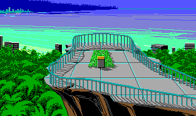
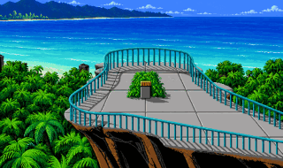

# SCIMate NG

SCIMate NG is a work-in-progress **cross-platform rebuild and migration of
[SCI Companion](https://github.com/icefallgames/SCICompanion)** for exploring,
editing, and rebuilding Sierra SCI games. Its main goal is to upgrade **SCI0 games
with EGA graphics to SCI1 with VGA graphics**, while preserving their gameplay, animations, and
parser-driven interaction.

Today, it provides a desktop resource browser and an editable workspace workflow
for SCI0 games, plus a command-line tool for resource editing and experimental
SCI1 migration.

## The goal: SCI0 → SCI1 VGA

We want to make it practical to give classic SCI0 games new VGA artwork without
recreating the entire game. That means bringing backgrounds and animated sprites
into the SCI1 graphics format, adapting game scripts and parser behaviour, and
making the resulting game work in an SCI interpreter such as ScummVM.

The comparison below illustrates the visual goal using a scene from *Leisure Suit
Larry 3 (LSL3)*:

| Original EGA artwork | VGA-style artwork |
| --- | --- |
|  |  |

Converting resource formats does not automatically redraw a game. The VGA-style
image shows the kind of replacement artwork an artist can supply; it is not an
automatic enhancement produced by SCIMate.

> **Artwork disclaimer:** The EGA picture is original artwork from LSL3. The
> VGA-style comparison is based on the same scene. Original game artwork belongs
> to its respective copyright holders; this project claims no ownership. These
> images are included for illustration and are not covered by the project's code
> license.

## What works today

- **Explore an SCI0 game:** browse and filter its resources, preview animated
  sprites and background visual/priority/control planes, inspect fonts and
  vocabulary, and read script disassembly.
- **Understand how resources connect:** inspect explanations and references,
  and explore candidate rooms, their pictures, and possible connections.
  These views use static analysis, so inferred relationships may be incomplete.
- **Create a portable editing project:** keep original resource snapshots alongside
  editable assets, reopen the project later, and refresh changes from disk.
- **Edit with familiar tools:** work with sprite/background PNGs, text and
  vocabulary tables, sound exports, and supported structured resource files.
  The desktop also includes a text editor.
- **Rebuild SCI0 resources:** turn workspace edits back into resource maps and
  volumes, with validation of the reconstructed output.

The desktop application is `scimate-desktop`; the command-line tool is `scimate`.
The current desktop editing workflow focuses on SCI0/EGA projects. Later SCI
formats also have inspection support through the CLI.

## Where VGA migration stands

**SCI1 VGA migration is implemented experimentally, but complete game
compatibility is still a work in progress.** The CLI can convert SCI0 pictures
and views, adapt supported script calls, and generate a replacement parser for
parser-based games. A workspace can supply VGA-colour sprite PNGs and replacement
background artwork.

Without replacement artwork, conversion retains the original visual appearance
in the new format. With replacements, colour and transparency limits still apply.
Some picture operations and parser cases remain unsupported, and converted games
still need real interpreter checks for startup, gameplay, room transitions,
sound, and save/restore. Successfully writing and verifying resources does not
establish that an entire game is playable.

See [VGA migration](docs/vga-migration.md) for the supported artwork workflow and
remaining limits, and [SCI1 migration](docs/sci1-migration.md) for the broader
compatibility work.

## Using SCIMate

Start with your own SCI0 game files. In the desktop app, create a project from the
game directory, browse its resources, and open a resource folder to edit assets
in your preferred editor. Refresh from disk to see your changes, then use
**Build Resources to New Folder** to reconstruct SCI0 resources.

The equivalent command-line workflow is:

```sh
scimate export /path/to/game /path/to/workspace
scimate import /path/to/workspace /path/to/new-resource-output
```

To try the experimental VGA upgrade with workspace edits:

```sh
scimate import --target-engine sci1 --graphics vga /path/to/workspace /path/to/new-vga-output
```

To convert directly from an original game directory:

```sh
scimate migrate --to sci1 --graphics vga /path/to/game /path/to/new-vga-output
```

Use a new output directory to keep your source game and workspace intact.
`--force` replaces an existing destination directory. Add `--verbose` to any
command for progress details, or use `scimate help <command>` for its options.

Resource output is not a complete game installation: you still need a suitable
interpreter and any other files required by the game. SCIMate does not currently
provide a game launcher, an integrated high-level script decompiler, or a source
compiler.

## Guides

- [Desktop projects](docs/projects.md) and [room explorer](docs/room-explorer.md)
- [Exporting and rebuilding SCI0 resources](docs/sci0-roundtrip.md)
- [Editing sprites](docs/sci0-views.md) and [backgrounds](docs/sci0-pictures.md)
- [Sounds, fonts, cursors, text, and vocabulary](docs/sci0-assets.md)
- [Structured resources](docs/structured-resources.md) and [script inspection](docs/sci0-scripts.md)
- [Resource explanations](docs/sci0-explain.md)
- [Building and testing](docs/building.md)

The code is licensed under [GPL-2.0-or-later](COPYING). See
[provenance](docs/provenance.md) for third-party source acknowledgements.
