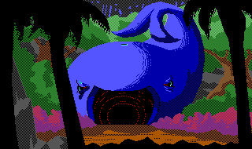
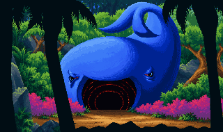
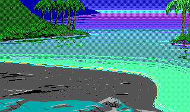
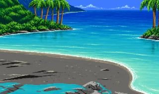
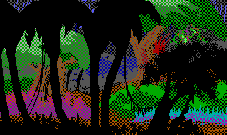
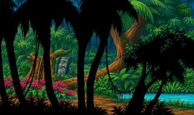

# Recreating EGA artwork as VGA with AI

SCIMate converts resource formats; an image-generation tool can supply new
artwork for the exported PNGs. This guide describes the workflow used for room
backgrounds and close-up portraits: inspect the original, recreate it with a
consistent style reference, prepare a limited-colour PNG, and preserve the EGA
version before installing the replacement.

Use [the art-direction guide](vga-art-style.md) and
[the reusable prompt](vga-art-prompt.md) together. The current guide describes a
tropical game; adapt its material colours and lighting for other games while
keeping the geometry and pixel-art requirements.

## Prepare a workspace and references

Export your own game to an editable workspace using SCIMate's desktop project
workflow or CLI:

```sh
scimate export /path/to/game /path/to/workspace
```

Find the resource in `manifest.tsv`. Picture directories such as
`pictures/0000263/` use the manifest's workspace index, which need not equal the
game's picture number. A picture bundle contains `visual.png`, `priority.png`,
`control.png`, metadata, and the original resource snapshot.

Choose one approved VGA image as a rendering and colour reference. Supply it
alongside the original EGA image, with their roles explicitly labelled:

- The EGA target supplies the scene, subject, geometry, and framing.
- The approved VGA reference supplies colour treatment and rendering style only.

Do not transfer scenery from the reference into the target. Keep private game
workspaces and resource output outside Git. The explicitly included comparison
images below document the workflow; they are not a distributable game build.

## Generate the recreation

Attach the target and reference to an image-generation tool. In Codex, use the
imagegen skill and built-in image generation. Inspect the target before writing
the prompt; describe ambiguous shapes without inventing their purpose.

Ask for early-1990s SCI1 VGA painted pixel art, coherent shaded colour clusters,
and no EGA checkerboards, ordered dithering, stippling, grain, or photographic
detail. Request the original 320:190 framing and an opaque background for
pictures. Generation may return a larger image, so preparation is still needed.

For rooms, preserve paths, exits, horizon, perspective, object footprints,
interaction landmarks, and foreground occlusion silhouettes. Match the original
light direction, adapting the style reference to the room's lighting. Avoid
extra objects, characters, text, borders, and UI.

For portraits, preserve identity, facial landmarks, gaze, expression, hair
silhouette, jewellery, and crop. Natural skin shading can replace EGA colour
approximations, but added facial detail must not change the character or pose.

Review the generated image against the original. Correct geometry or identity
drift before reducing it. A visually attractive result can still be unsuitable
for existing interaction and priority maps.

### Ambiguous details and hallucinations

At 320×190, EGA colour clusters can be ambiguous. AI may invent clouds, cliffs,
water, or other scenery while trying to make the small source image readable.
Even a convincing recreation can change what the room actually contains.

Improve the prompt by describing known materials and landmarks explicitly.
Where available, include the game's room description or relevant look/examine
text as supporting context. Distinguish confirmed scene details from uncertain
interpretations, and use that text to clarify the image rather than add objects
outside its framing. For ambiguous areas, specify what must remain and which
interpretations to avoid. Do not describe an uncertain blue patch as water
unless the game or other evidence supports that reading.

Compare every generated candidate with both the source and the room context.
If it invents a feature, revise the prompt with a targeted correction and
regenerate or edit that area. Better prompting and room descriptions can help,
but do not replace visual review.

### Example comparisons

These LSL3 examples use workspace folder indices, not game picture numbers.
They illustrate both the style change and details that need review.

| Workspace example | Original EGA | AI VGA recreation |
| --- | --- | --- |
| `0000352`: blue sculptural head |  |  |
| `0000328`: coastal scene |  |  |
| `0000280`: hallucinated water |  |  |

In `0000280`, the VGA recreation interprets the blue area along the lower right
as water. This is an observed hallucination, not an approved scene feature.
The coastal example also shows how a recreation can elaborate distant scenery
and clouds; those additions need checking against the intended room.

Original game artwork belongs to its respective copyright holders. These
comparison images, including AI recreations based on the originals, are included
for illustration and are not covered by the project's code license.

## Prepare and inspect the PNG

Pictures must be **320×190 and fully opaque**. The game displays aspect-corrected
pixels that appear taller; judge both the native artwork and its in-game display.
Keep `priority.png`, `control.png`, picture metadata, and original snapshots
unchanged.

The original background masks are not automatically correct for regenerated
art. Priority and control maps generally remain quite applicable when the
composition is preserved, but small shifts in edges or foreground silhouettes
can still cause glitches in occlusion, movement, or interaction. Keeping the
maps unchanged is the starting point, not a guarantee. Check them against the
replacement in the interpreter; correct the art to fit the maps or deliberately
adjust the affected map areas using the existing editing workflow. Recheck the
result after either kind of correction.

The SCI1 VGA importer preserves EGA palette entries 0–15, allocates additional
colours at indices 16–254, and reserves index 255 for transparency. Reduce the
artwork without dithering to at most **239 RGB colours**. The importer assigns
game palette entries; PNG palette indices do not need to match those entries.

For example, ImageMagick can prepare and inspect a generated picture:

```sh
magick generated.png -filter point -resize '320x190!' \
  -alpha off +dither -colors 239 PNG8:visual-vga.png
magick identify -format '%wx%h colours=%k opaque=%[opaque]\n' visual-vga.png
```

Use forced dimensions only after confirming the composition has the intended
aspect ratio. Nearest-neighbour resizing preserves hard edges but does not
guarantee good pixel clusters; inspect the reduced PNG itself for lost features,
stray pixels, banding, and changed silhouettes. Record the prompt, reference,
generation tool, and final file location so later rooms can follow the same style.

## Install the picture while preserving the original

Keep a temporary `visual-vga.png` for review. Once selected, rename the original
`visual.png` to **`visual-ega.png`** and install the prepared VGA image as
**`visual.png`** in the same picture directory. The importer reads `visual.png`;
a sibling named `visual-vga.png` alone does not activate the replacement.

If `visual-ega.png` already exists, preserve it. Use that EGA backup as the target
for subsequent recreations and retain the previous VGA candidate separately if
needed. Do not overwrite the backup or edit the raw picture payload alongside
the PNG replacement. To revert, restore the EGA backup to `visual.png`.

## Sprites and animations

Views require a frame-aware workflow. Inspect every loop, cel, placement offset,
and mirror relationship before generating. Preserve cel dimensions, silhouettes,
registration, binary transparency, and animation identity. Keep colours and
lighting consistent across the complete animation; do not add scenery, padding,
or shadows outside the original silhouette.

Save a complete set of replacement cel PNGs with matching filenames in the view
bundle's `vga/` directory, together with an unchanged copy of `view.tsv`. Keep
the parent EGA cels and raw payload untouched. Reduce all cels against a shared
palette with at most 239 additional RGB colours across the entire view, rather
than independently assigning each frame that many colours. Preserve alpha as
fully transparent or fully opaque. SCI1 VGA import reads these overrides; SCI0
import requires EGA colours and ignores `vga/`. See the
[reusable prompt](vga-art-prompt.md) and [VGA migration guide](vga-migration.md).

## Build and check in an interpreter

When the selected artwork is installed, manually build to a new output folder:

```sh
scimate import --target-engine sci1 --graphics vga \
  /path/to/workspace /path/to/new-vga-output
```

See [building an edited workspace for SCI1](workspace-sci1-build.md) for import
details. Artwork preparation does not itself run an import or prove playback.

Open the converted game in ScummVM and check the edited picture in context:
room transitions, walkable boundaries, sprite occlusion, interaction landmarks,
portrait framing, menu input, and save/restore. Check neighbouring pictures and
sprites for palette consistency. Successful PNG validation and resource
encoding do not establish interpreter compatibility. If playback crashes,
inspect the crash report and migration report before assuming the art is faulty;
script, parser, and resource-format migration can fail independently of the PNG.
